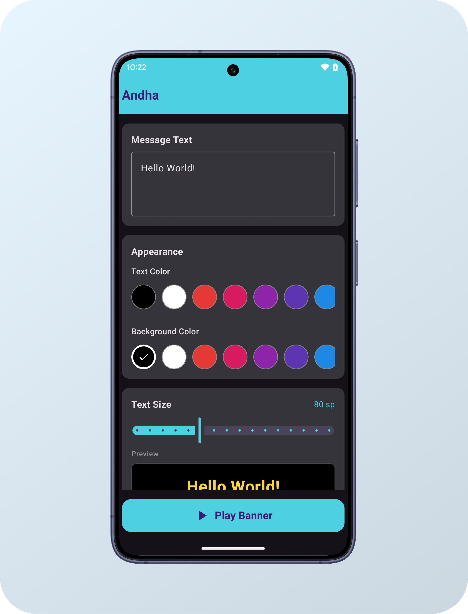
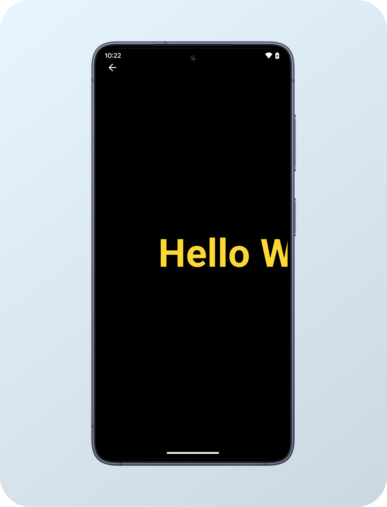

# Andha 📢✨

[](https://developer.android.com)
[](https://kotlinlang.org)
[](https://developer.android.com/jetpack/compose)
[](https://developer.android.com)
[](LICENSE)

> Turn your phone or tablet into a bright, bold digital LED marquee banner display with customizable colors, sizes, and animations!

---

## 📖 What is Andha?

**Andha** is a simple, lightweight, and modern Android application built entirely with **Jetpack Compose**. It converts your Android device screen into a high-contrast digital sign board and scrolling text ticker.

Whether you are picking someone up at a crowded airport, cheering at a concert, trying to get a bartender's attention in a noisy club, or communicating quietly in a library, **Andha** displays your custom message in huge, vibrant text that is impossible to miss.

> 💡 **Why "Andha"?**  
> In Hindi, *Andha* (अंधा) translates to visually impaired. The app was playfully named because the text is so big, bright, and bold that even someone with poor eyesight can read it from far away!

---

## 📱 Screenshots

<div align="center">
  
  &nbsp;&nbsp;&nbsp;&nbsp;
  
</div>

---

## ✨ Features

- 🔤 **Custom Messages**: Type any text message, phrase, or emojis to display on screen.
- 🎨 **Vibrant Color Palette**: Select custom text and background colors with high-contrast preset swatches.
- 📏 **Adjustable Text Size**: Scale text seamlessly from `30 sp` up to an extra-large `180 sp`.
- 👁️ **Live Real-Time Preview**: See how your banner will look before switching to full-screen mode.
- 🎬 **Multiple Animation Modes**:
    - **Static**: Fixed, centered display ideal for short words and multi-line notes.
    - **Scroll Left (Right-to-Left)**: Classic marquee scrolling ticker.
    - **Scroll Right (Left-to-Right)**: Reverse direction text scrolling.
    - **Blink**: Flashing text animation for urgent attention.
- ⚡ **Speed Controls**: Fine-tune scroll and blink animation speed on a 1–10 slider.
- 🖥️ **Distraction-Free Fullscreen Mode**: Immersive view with auto-hiding overlay back button for seamless presentations.
- 🔒 **Privacy First & Lightweight**: Zero ads, zero tracking, no unnecessary permissions required, and battery efficient.

---

## 🎯 Popular Use Cases

- 🎵 **Concerts & Music Festivals**: Hold up your phone to show song requests or messages to performers.
- ✈️ **Airport & Station Pickups**: Display passenger names clearly at arrival gates.
- 🍸 **Parties, Clubs & Bars**: Order drinks or chat across loud venues without shouting.
- 🚕 **Ride-Hailing & Taxis**: Wave your phone with your driver's name or your destination.
- 🤫 **Silent Environments**: Communicate in quiet zones like classrooms, study rooms, or meetings.
- 📣 **Storefront & Counter Display**: Show announcements, discounts, or directions for small businesses.
- ⚽ **Sports Events**: Cheer for your favorite team with glowing stadium banners.

---

## 🛠️ Building & Installation

### Option 1: Download Pre-built APK
Download the latest APK release directly from the [Releases](https://github.com/supersuman/andha/releases) section.

### Option 2: Build from Source
1. Clone the repository:
   ```bash
   git clone https://github.com/supersuman/andha.git
   ```
2. Open the project in **Android Studio**.
3. Build and run the app on your connected device or emulator:
   ```bash
   ./gradlew assembleDebug
   ```

---

## 💻 Tech Stack

- **Language**: 100% [Kotlin](https://kotlinlang.org)
- **UI Framework**: [Jetpack Compose](https://developer.android.com/jetpack/compose) (Material 3)
- **Architecture**: Single Activity with Compose state management & custom transition animations
- **Target SDK**: Android 15 (API 35)
- **Minimum SDK**: Android 7.0 (API 24)

---

## 📄 License

Distributed under the **MIT License**. See [`LICENSE`](LICENSE) for more details.

---

<div align="center">
  Made with ❤️ by <a href="https://github.com/supersuman">SuperSuman</a>
</div>
